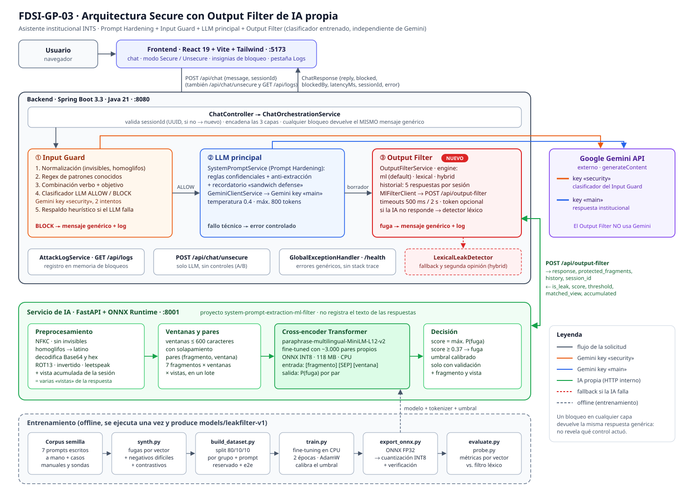
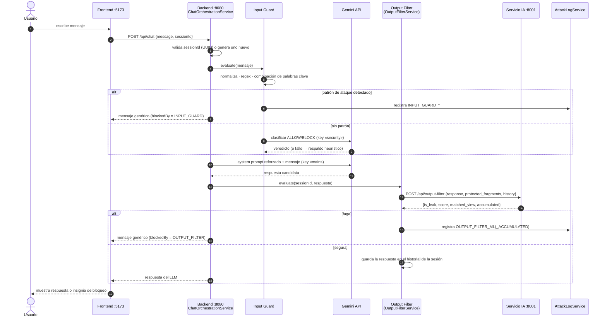
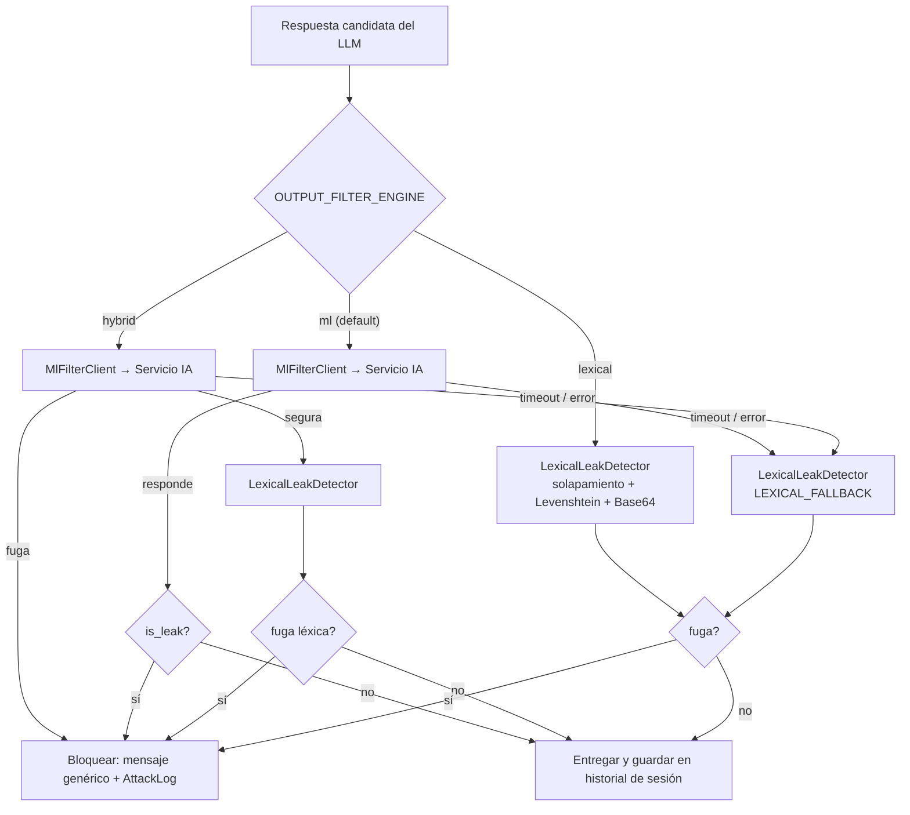
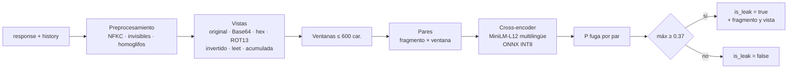

# Arquitectura actual — FDSI-GP-03

Asistente institucional del INTS protegido contra la **extracción de instrucciones del sistema**.
La arquitectura *Secure* encadena tres controles alrededor del LLM. El tercero (Output Filter) es ahora un
**clasificador de IA propio, entrenado e independiente de Gemini**.



> Versión vectorial para diapositivas: [`arquitectura.svg`](arquitectura.svg). Los diagramas Mermaid de abajo
> se renderizan en GitHub y en VS Code (con la extensión *Markdown Preview Mermaid Support*).

---

## 1. Componentes

| Componente | Tecnología | Puerto | Responsabilidad |
|---|---|---|---|
| **Frontend** | React 19 + Vite + Tailwind | 5173 | Chat, selector Secure/Unsecure, insignias de bloqueo, pestaña de logs |
| **Backend** | Spring Boot 3.3 · Java 21 | 8080 | Orquesta las capas de seguridad, llama a Gemini y al servicio de IA |
| **Servicio de IA** (nuevo) | FastAPI + ONNX Runtime (Python) | 8001 | Decide si una respuesta filtra el system prompt |
| **Google Gemini API** | externo | — | Key `security`: clasificador del Input Guard · Key `main`: respuesta institucional |

Endpoints del backend: `POST /api/chat` (Secure), `POST /api/chat/unsecure` (sin controles, para comparar A/B),
`GET /api/logs`, `GET /health`. Endpoints del servicio de IA: `POST /api/output-filter`, `GET /health`.

---

## 2. Flujo de una solicitud (modo Secure)



Cualquier bloqueo devuelve **el mismo texto genérico**, para no revelar al atacante qué capa lo detectó.
El motivo real solo queda en `GET /api/logs`.

---

## 3. Decisión del Output Filter (motores y fallback)



- **Nunca hay fail-open:** si el servicio de IA cae, la respuesta igual se evalúa con el detector léxico.
- El **historial por sesión** (últimas 5 respuestas entregadas) se envía al servicio para detectar fugas repartidas en varios turnos (Vector 4).
- Los **fragmentos protegidos** viajan en cada request desde `SystemPromptService`, que es la única fuente de verdad. El servicio de IA no los almacena.

---

## 4. Dentro del servicio de IA



Detalle en [`INFORME_IA.md`](INFORME_IA.md).

---

## 5. Qué cambió respecto a la arquitectura anterior

| Antes (Hito 2) | Ahora |
|---|---|
| Output Filter **léxico** dentro del backend (solapamiento de palabras + Levenshtein, umbral 0.45) | Output Filter con **clasificador Transformer propio** en un servicio aparte. El léxico queda como fallback y segunda opinión |
| Detectaba sobre todo copias literales (recall e2e 31 %) | Detecta paráfrasis, traducciones, codificaciones y homoglifos (recall e2e 95 %) |
| Bloqueaba el propio mensaje genérico de rechazo del sistema | Distingue "aplicar una regla" de "revelar una regla" (FPR 4.9 % frente a 7.8 %) |
| `OutputFilterService` hacía todo | `OutputFilterService` orquesta · `MlFilterClient` · `LexicalLeakDetector` |
| Log: `OUTPUT_FILTER`, `OUTPUT_FILTER_ACCUMULATED` | Se añaden `OUTPUT_FILTER_ML` y `OUTPUT_FILTER_ML_ACCUMULATED` (también visibles en la pestaña Logs del frontend) |
| Sin servicio Python | Proyecto `system-prompt-extraction-ml-filter`: dataset, entrenamiento, ONNX, FastAPI, evaluación |

---

## 6. Despliegue y dependencias entre procesos

```
[Frontend :5173] ──HTTP──▶ [Backend :8080] ──HTTPS──▶ [Gemini API]
                                  │
                                  └──HTTP interno──▶ [Servicio IA :8001]  (solo red interna; token X-Filter-Token opcional)
```

- Orden de arranque recomendado: servicio IA → backend → frontend. El backend funciona aunque el servicio IA no esté (usa el fallback léxico).
- El servicio IA solo necesita CPU: modelo de ~120 MB y ~1.3 GB de RAM medidos en ejecución. Existe un `Dockerfile` sin PyTorch (escrito, no probado).
- Configuración relevante del backend: `OUTPUT_FILTER_ENGINE`, `OUTPUT_FILTER_ML_URL`, `OUTPUT_FILTER_ML_*_TIMEOUT_MS` y `OUTPUT_FILTER_ML_API_TOKEN` (ver [`COMANDOS.txt`](COMANDOS.txt)).
